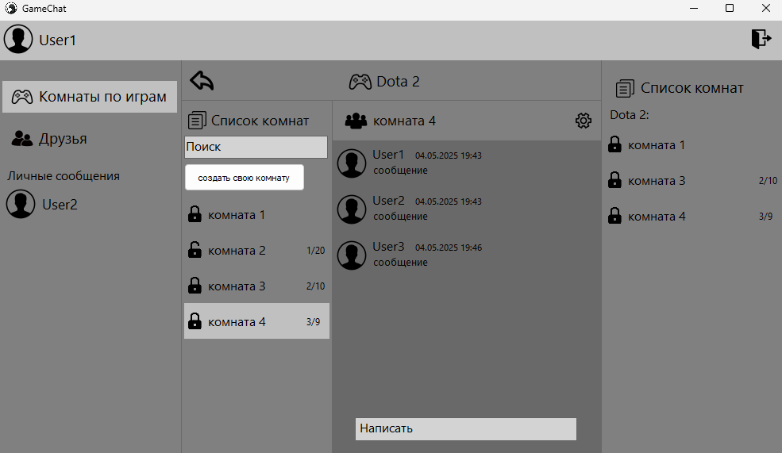
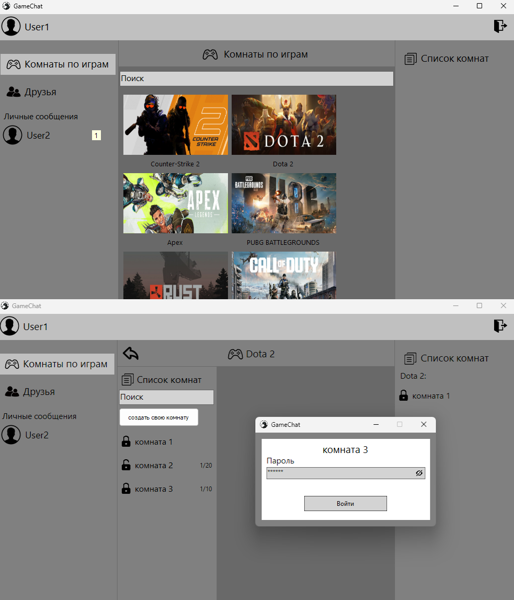
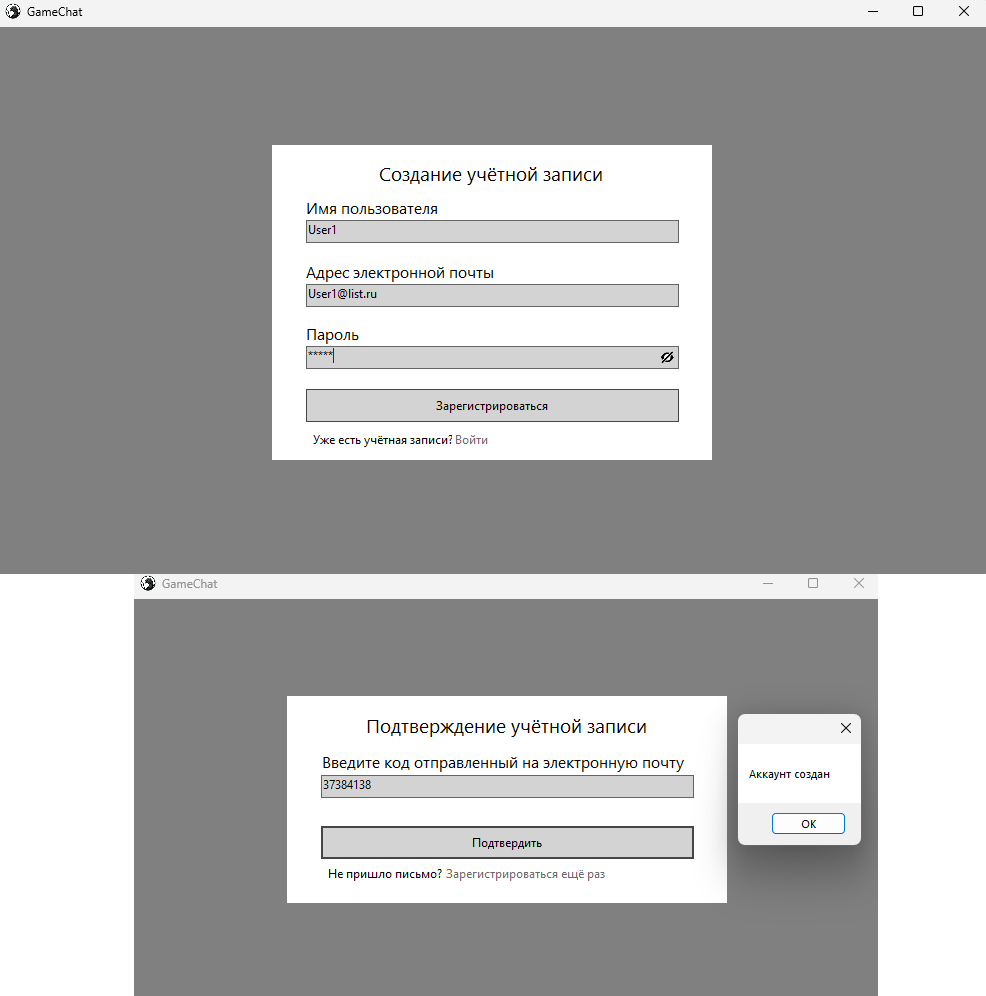
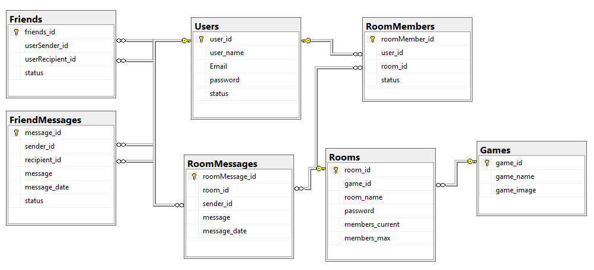

# 🎮 GameChat


Клиент-серверный игровой мессенджер: регистрация с подтверждением по email, друзья, тематические комнаты по играм и обмен сообщениями в реальном времени через WCF и TCP/IP.



*Чат игровой комнаты: слева — комнаты по игре Dota 2 (замок показывает, закрытая комната или открытая; `3/9` — занято участников из лимита, если лимит не задан, число не выводится), сверху — название открытого чата и кнопка настроек комнаты, справа — общий список всех комнат пользователя, сгруппированный по играм.*

> Дипломный проект, защищённый в 2025 году. Код в репозитории — та же версия, что сдавалась на защиту: после неё он не менялся. Акцент сделан на клиент-серверную архитектуру и сетевое взаимодействие, а не на безопасность и UI; ограничения кода перечислены в конце — и что именно я делаю иначе сейчас.

---

## Что умеет

- **Регистрация и вход** — аккаунт с подтверждением по email (SMTP), статус «в сети / не в сети».
- **Друзья** — добавление в друзья и заявки со статусами: отправлена, принята, отклонена.
- **Личные сообщения** — диалоги между пользователями, счётчик непрочитанных.
- **Комнаты по играм** — каталог игр, комнаты внутри игры, приватные комнаты с паролем и лимитом участников (`3/9`, `2/10`).
- **Чат комнаты в реальном времени** — сообщение сохраняется в БД и мгновенно уходит всем онлайн-участникам через callback-контракт WCF.
- **Модерация** — создатель комнаты может забанить участника: доступ закрывается, клиент получает уведомление и покидает комнату.
- **Настройки комнаты** — смена пароля, лимита участников, удаление комнаты.



*Каталог игр и комнаты внутри выбранной игры: закрытый замок — комната с паролем, открытый — без пароля; `1/20` — лимит участников включён, если лимита нет, число не показывается.*



*Регистрация: пользователь вводит имя, email и пароль, затем подтверждает аккаунт кодом, который приходит на почту по SMTP. Без подтверждения вход невозможен.*

---

## Стек

| Слой                        | Технологии                                                   |
| :-------------------------- | :----------------------------------------------------------- |
| Язык и платформа            | C#, .NET Framework 4.8                                       |
| Клиент                      | Windows Forms (WinForms)                                     |
| Сервер                      | WCF: два сервиса, `netTcpBinding`, `mexHttpBinding`          |
| Транспорт                   | TCP/IP, callback-контракты для push-уведомлений              |
| База данных                 | Microsoft SQL Server, ADO.NET (`SqlConnection`, `SqlDataAdapter`, `SqlDataReader`) |
| Хранение и развёртывание БД | `.bacpac` (data-tier application)                            |

---

## Архитектура

```
┌──────────────────────────┐
│  Клиент (WinForms)       │
│  формы: Login, Rooms,    │
│  ChatRoom, FriendList    │
└───────────┬──────────────┘
            │  netTcpBinding (TCP/IP)
            ▼
┌───────────────────────────────────────────┐
│  Сервер WCF (Host)                        │
│                                           │
│  IService   — авторизация, регистрация,   │
│               комнаты, друзья             │
│  IService2  — сообщения в реальном времени│
│               через callback-контракт     │
└───────────┬───────────────────────────────┘
            │  ADO.NET
            ▼
┌──────────────────────────┐
│  SQL Server (GameChat)   │
└──────────────────────────┘
```

**Почему два сервиса.** `IService` обслуживает запросы «клиент → сервер»: проверка пароля, создание комнаты, список друзей. `IService2` дополнительно держит обратный канал: сервер сам вызывает метод на клиенте, когда приходит новое сообщение. Это и есть push в реальном времени — без опроса сервера.

**Методы `Service2`.** `Connect` / `Disconnect` регистрируют онлайн-пользователя и его callback-канал, `SendMessageFriend` и `SendMessageInRoom` сохраняют сообщение и рассылают его адресатам, `ban` выкидывает участника из комнаты.

### Структура репозитория

| Путь                             | Что внутри                                                   |
| :------------------------------- | :----------------------------------------------------------- |
| `GameChat/`                      | Клиент на WinForms: формы, пользовательские контролы, подключённые WCF-сервисы |
| `Server_GameChat/`               | Сервер: проект `WCF` (контракты и реализация) и проект `Host` (запуск сервисов) |
| `DataBase/GameChat.bacpac`       | Дамп базы данных для развёртывания                           |
| `screenshots/`                   | Скриншоты интерфейса и ER-диаграмма                          |
| `диплом.pdf`, `презентация.pptx` | Пояснительная записка и презентация к защите                 |

---

## Модель базы данных



*ER-диаграмма: семь сущностей, связи пользователей, друзей, комнат и сообщений.*

| Сущность           | Атрибуты                                                     |
| :----------------- | :----------------------------------------------------------- |
| **Users**          | `user_id` (PK), `user_name`, `email`, `password`, `status`   |
| **Friends**        | `friends_id` (PK), `userSender_id` (FK), `userRecipient_id` (FK), `status` |
| **FriendMessages** | `message_id` (PK), `sender_id` (FK), `recipient_id` (FK), `message`, `message_date`, `status` |
| **Games**          | `game_id` (PK), `game_name`, `game_image`                    |
| **Rooms**          | `room_id` (PK), `game_id` (FK), `room_name`, `password`, `members_current`, `members_max` |
| **RoomMembers**    | `roomMember_id` (PK), `user_id` (FK), `room_id` (FK), `status` |
| **RoomMessages**   | `roomMessage_id` (PK), `room_id` (FK), `sender_id` (FK), `message`, `message_date` |

---

## Ключевой механизм: push-уведомления через callback

Контракт сервера объявляет `CallbackContract` — интерфейс, который реализует клиент. Сервер вызывает его методы, когда нужно что-то доставить без запроса клиента.

```csharp
[ServiceContract(CallbackContract = typeof(IService2CallBack))]
public interface IService2
{
    [OperationContract] void Connect(string user_name);
    [OperationContract] void Disconnect(string user_name);
    [OperationContract] string SendMessageFriend(string message, string sender, string recipient, DateTime dateTime);
    [OperationContract] string SendMessageInRoom(int room_id, string sender_name, string message, DateTime dateTime);
    [OperationContract] string ban(int room_id, string user_name, string game);
}

public interface IService2CallBack
{
    [OperationContract(IsOneWay = true)] void SendMessageFriendCallBack(string message, string sender, DateTime dateTime);
    [OperationContract(IsOneWay = true)] void SendMessageInRoomCallBack(int room_id, string sender_name, string message, DateTime dateTime);
    [OperationContract(IsOneWay = true)] void banCallBack(int room_id, string game);
}
```

Сервер хранит список онлайн-пользователей вместе с их `OperationContext`. При отправке сообщения он пишет его в БД, находит получателя в этом списке и вызывает его callback:

```csharp
if (cmd.ExecuteNonQuery() == 1)
{
    answer = "сообщение отправлено";
    for (int i = 0; i < users.Count; i++)
        if (users[i].user_name == recipient)
            users[i].operationContext
                .GetCallbackChannel<IService2CallBack>()
                .SendMessageFriendCallBack(message, sender, dateTime);
}
```

Сообщение приходит получателю сразу после сохранения в БД — без перезагрузки экрана и без периодического опроса. Если пользователь офлайн, сообщение остаётся в базе и подгружается при следующем входе.

---

## Как запустить

**Требования:** Windows, Visual Studio с workload «.NET desktop development», SQL Server (Express или Developer Edition).

1. **Развернуть базу.** В SSMS: правый клик по «Databases» → **Deploy Data-tier Application** → выбрать `DataBase/GameChat.bacpac` → задать имя `GameChat`.

2. **Заполнить справочник игр.** В таблице `Games` должны быть записи — иначе каталог игр на клиенте будет пустым:

   ```sql
   INSERT INTO Games (game_name) VALUES ('Dota 2'), ('Counter-Strike 2'), ('Apex Legends');
   ```

3. **Настроить строку подключения.** В `Server_GameChat/WCF/app.config` и `App.config` указать свой сервер вместо `Data Source=DENNY\SERVER`.

4. **Запустить сервер.** Открыть `Server_GameChat/Server_GameChat.sln`, запустить проект `Host` — сервисы поднимутся на портах из `app.config` (`net.tcp://localhost:8002` и `:8004`).

5. **Запустить клиента.** Открыть `GameChat/GameChat.sln`, проверить адреса сервисов в `App.config` и запустить приложение. Для проверки чата в реальном времени запустите два экземпляра клиента и войдите под разными аккаунтами.

> Адреса в `app.config` привязаны к машине, где писался диплом (`192.168.0.138`, `94.233.10.179`). Для локального запуска достаточно заменить их на `localhost`.

---

## Ограничения и что я изменил бы сейчас

Проект писался в сжатые сроки перед защитой и армией, и это видно по коду. Честно перечисляю слабые места — они же стали причинами, по которым следующие проекты сделаны иначе:

| Проблема в этом коде                                         | Как делаю сейчас                                             |
| :----------------------------------------------------------- | :----------------------------------------------------------- |
| SQL собирается конкатенацией строк — **уязвимость к SQL-инъекциям** | Параметризованные запросы: `SqlParameter`, Dapper, EF Core   |
| Пароли хранятся в открытом виде                              | BCrypt за интерфейсом `IPasswordHasher`                      |
| Строка подключения захардкожена в коде                       | Конфигурация и переменные окружения                          |
| Нет слоя репозиториев: SQL прямо в формах и сервисах         | Сервисный слой, репозитории, DTO                             |
| Нет тестов                                                   | xUnit + Moq, 52 теста в [LibraryAPI](https://github.com/Escape-projects/LibraryAPI) |
| Нет логирования, ошибки показываются `MessageBox`            | Serilog, глобальный обработчик исключений                    |

Следующий проект на том же стеке — [LibraryAPI](https://github.com/Escape-projects/LibraryAPI) (2026): EF Core вместо ручного ADO.NET, JWT с refresh-токенами, роли, кэширование, тесты, Docker. Домен другой (библиотека, а не мессенджер), но решаемые задачи те же — и решены они иначе.

---

## Контакты

- GitHub: [@escape-re](https://github.com/escape-re)
- Telegram: [@escape_137](https://t.me/escape_137)
- Email: Denny2002@list.ru
